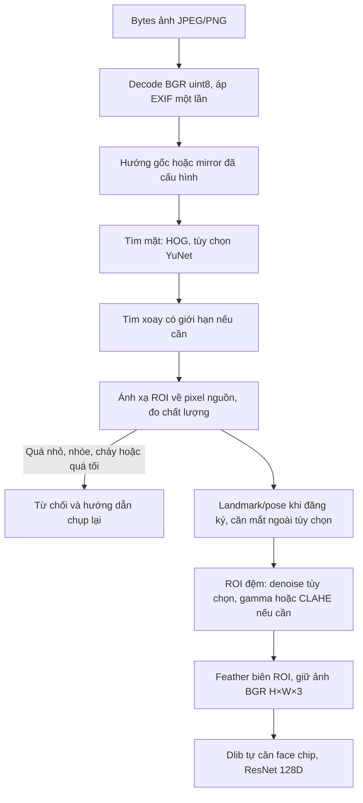

# Thuật toán xử lý ảnh trong phiên bản hiện hành

## 1. Phân định các bước

Tiền xử lý ở đây nhận **ảnh**, cải thiện hình học/ánh sáng/nhiễu khi cần rồi trả
**ảnh** cho model. Phát hiện mặt xác định ROI; kiểm tra chất lượng quyết định có
nên xử lý; dlib biến ảnh thành vector; matching/tracking và ghi điểm danh thuộc
các bước tiếp theo. Không gọi việc lưu năm ảnh là huấn luyện ResNet.

Luồng v3 mặc định:

Luồng nhiều mặt có tìm thêm roll để cứu mặt bị bỏ sót khi đã phát hiện người
khác. Đăng ký chỉ nhận đúng một mặt; điểm danh xử lý từng ROI độc lập.

## 2. Hợp đồng và tọa độ

Nguồn chính: [preprocessing.py](../ai_pipeline/preprocessing.py),
[analysis.py](../ai_pipeline/analysis.py), [quality.py](../ai_pipeline/quality.py).

- Ảnh trong pipeline là NumPy `uint8`, BGR, kích thước `H×W×3`. Chuyển RGB khi
  gọi dlib; không thay ảnh màu bằng ảnh biên hoặc grayscale.
- OpenCV giải mã với `IMREAD_COLOR`; EXIF đã được xử lý tại decode, không xoay lại.
- `PreparedFrame.source_to_image` là ma trận thuần nhất 3×3. Một điểm nguồn p
  chuyển sang ảnh xử lý theo p′ = T p; phép ngược dùng T⁻¹.
- Box API luôn là `[x,y,w,h]` theo ảnh đã decode/EXIF. CSS mirror của preview
  chỉ đổi cách hiển thị, không đổi ảnh gửi đi.
- Biến đổi không sửa array đầu vào tại chỗ; phần ngoài ROI giữ pixel gốc.
  Crop chân dung 400×600 lưu để hiển thị không phải đầu vào bắt buộc của ResNet.

## 3. Hình học và hướng ảnh

**Lật ngang:** `mirror_input=true` chỉ áp dụng khi biết nguồn gửi pixel bị lật.
Không tự suy đoán mặt có bị mirror từ một ảnh; khuôn mặt gần đối xứng không cung
cấp thông tin đáng tin cậy để làm việc đó. Preview gương không phải lỗi dữ liệu.

**Xoay ảnh:** thử 90°, 180°, 270° và roll ±20°, ±40° trong giới hạn cấu hình,
khi cần cứu detector. Với v2/v3, ưu tiên hướng thẳng, sau đó các góc vuông rồi
roll; tổng ngân sách mặc định tối đa tám lần detector. V3 có một lần gamma
chỉ để tìm box trong ảnh tối bị bỏ sót; lượt này cũng dùng ngân sách đó.

**Căn mắt ngoài:** lấy trung bình các điểm mỗi mắt, sắp theo tọa độ x; góc
θ = atan2(yR−yL, xR−xL). `getRotationMatrix2D` tạo phép xoay quanh trung điểm
hai mắt với scale=1; warp dùng nội suy tuyến tính. Đó là căn roll trong mặt phẳng,
không sửa yaw 3D hay dựng phần mặt bị che. Mắt cách nhau <8 px, landmark lỗi,
góc vượt giới hạn hoặc biến đổi làm cắt mặt sẽ bị bỏ qua/fallback. V2/v3 gộp
ma trận để render từ nguồn, giảm số lần nội suy. Căn ngoài mặc định **tắt** vì
dlib đã tự căn face chip. Xem [OpenCV về warpAffine](https://docs.opencv.org/4.x/da/d6e/tutorial_py_geometric_transformations.html)
và [ví dụ nhận diện dlib](https://dlib.net/dnn_face_recognition_ex.cpp.html).

**Yaw/pitch đăng ký:** dùng sáu điểm mũi, cằm, mắt, khóe miệng trong landmark 68
điểm, mô hình đầu 3D cố định và `solvePnP`. Camera matrix dùng tiêu cự xấp xỉ
bằng chiều rộng ảnh, tâm ở giữa ảnh; chưa hiệu chuẩn intrinsics. Vì vậy đây là
ước lượng hướng để hướng dẫn, không phải phép đo góc chuẩn thiết bị.
Xem [recognition.py](../ai_pipeline/recognition.py).

Khung nhìn thẳng chấp nhận |yaw|≤23°, |pitch|≤16°. Web lấy yaw/pitch của khung
đó làm mốc: các góc sau cần lệch yaw ít nhất 14° hoặc pitch ít nhất 7°; ưu tiên
yaw khi cùng lệch hai trục. Client cũ không gửi `neutral_yaw` giữ nhánh ngưỡng
cũ (yaw 18°, pitch tương đối 8° khi có mốc pitch). Đây là ngưỡng UX heuristic,
không liên quan ngưỡng khoảng cách nhận diện.

## 4. Đo chất lượng trước tăng cường

Box trong ảnh xoay được ánh xạ về đa giác trên nguồn; mask loại nền phản xạ
hoặc vùng canvas nhân tạo. Kích thước nguồn được kiểm tra trước resize.

| Đại lượng | Cách tính trong code | Vai trò |
| --- | --- | --- |
| Kích thước | Cạnh nhỏ nhất ROI nguồn | Chặn <80 px. |
| Độ sáng | Trung bình mức xám trên mask | Thông thường chặn <45 hoặc >230. |
| Độ nét | Var(∇²I) trên pixel hợp lệ | Chặn <20; nhiễu cũng có thể làm chỉ số tăng. |
| Tương phản | P90(I)−P10(I) | Chặn <12; dùng để chọn CLAHE. |
| Vùng tối/cháy | Tỷ lệ I≤5 / I≥250 | Chặn nếu một tỷ lệ >0,5. |
| Tenengrad | Trung bình Gx²+Gy² sau chuẩn hóa 128×128 | Chẩn đoán, không là hard gate độc lập. |
| Nhiễu | MAD high-pass vùng gradient thấp / (0,67448975×6) | Chọn bilateral nếu bật denoise. |
| Nhiễu xung | Pixel gần 0/255, lệch median ≥40 | Chọn median nếu tỷ lệ ≥0,01. |

V3 chỉ cho phép cứu nhánh **quá tối** nếu sáng nguồn≥30, vùng tối≤0,5,
tương phản≥20 và Laplacian variance≥20. Sau tăng cường, ROI phải vượt lại
quality gate. Ảnh quá mờ, quá nhỏ hoặc mất chi tiết không được cứu bằng tăng sáng.
Các ngưỡng là lựa chọn của dự án, chưa được tối ưu trên tập camera độc lập.

## 5. Ánh sáng, lọc nhiễu và feather ROI

ROI có đệm 25% chiều rộng/cao mỗi phía, giới hạn trong ảnh. Nếu ảnh đủ tốt,
không có phép tăng cường nào; giữ nguyên pixel là kết quả hợp lệ.

**Gamma:** khi sáng <90 hoặc >175, tính γ = clip(log(120/255)/log(μ/255),
0,65, 1,4), trong đó μ là sáng nguồn đã chặn miền số hợp lệ. Tạo LUT
Y′ = round(255(Y/255)^γ) trên kênh Y của YCrCb; γ<1 làm sáng, γ>1 làm tối.

**CLAHE:** nếu sáng không cần gamma nhưng tương phản <55, cân bằng histogram
thích nghi có giới hạn trên Y; clip limit mặc định 1,5, lưới từ 2 đến 8 ô mỗi
chiều tùy kích thước ROI. Nhánh adaptive chọn gamma **hoặc** CLAHE, không chồng
cả hai. Cơ sở của CLAHE và nguy cơ khuếch đại nhiễu được mô tả trong
[tài liệu OpenCV](https://docs.opencv.org/4.x/d5/daf/tutorial_py_histogram_equalization.html).

**Lọc nhiễu:** mặc định off. Nếu bật adaptive, ưu tiên median 3×3 khi nhiễu
xung≥1%; nếu không thì bilateral d=5, sigmaColor=15, sigmaSpace=3 khi sigma
ước lượng≥4. Chọn rõ median/bilateral vẫn qua điều kiện nhiễu; không làm mịn
mọi ảnh. Phép lọc có thể xóa texture cần cho nhận diện, phải đo ablation.

**Feather v3:** pixel mặt nhận toàn bộ xử lý; trong vùng đệm, alpha giảm dần
đến 0 ở biên. Ảnh ra Iout=(1−α)Inative+αIenhanced, làm tròn về uint8.
Đây là giảm đường nối nhân tạo của ROI, không phải khôi phục chi tiết.

Nếu enhancement hoặc căn mắt lỗi, fallback về ảnh nguồn đã qua kiểm tra chất
lượng. Nếu encode ảnh xử lý lỗi, có thể thử ảnh chuẩn bị trước tăng cường;
vẫn giữ model_version của profile vì nhánh fallback là một phần của thuật toán.
Nếu không có vector hợp lệ thì từ chối, không lấy vector cũ để điểm danh mới.

## 6. Các thuật toán chỉ dùng để khảo sát

| Thuật toán | Vị trí | Được dùng làm ảnh đầu vào runtime? |
| --- | --- | --- |
| Kirsch tám hướng (nhân +5/−3, tâm 0, lấy max đáp ứng) | preprocessing.py, preview_preprocessing.py | Không; ảnh chẩn đoán biên. |
| Multi-scale Retinex | experiments.py, benchmark | Không; biến thể thí nghiệm ánh sáng. |
| Tan–Triggs (gamma, DoG, chuẩn hóa robust, tanh) | experiments.py, benchmark | Không; biến thể thí nghiệm. |
| Undistort từ intrinsics camera | Chưa cài vào runtime | Không có thông số hiệu chuẩn để áp dụng đáng tin cậy. |
| HOG+SVM/DFT chống giả mạo | Đã gỡ khỏi runtime | Không. HOG detector còn lại không phải HOG+SVM PAD. |

## 7. Phần sau tiền xử lý

Dlib trích embedding float32 128 chiều bằng trọng số pretrained; mặc định một
lần jitter khi đăng ký. Với probe e và các mẫu tj của sinh viên i, khoảng cách
di=minj ||e−tj||₂. Chọn người tốt nhất nếu d1≤0,52 và d2−d1≥0,04. Một người
trong gallery không có d2 hữu hạn; code vẫn yêu cầu d1 qua ngưỡng. Các số này là
ngưỡng cấu hình của dự án, không phải xác suất tự tin hoặc accuracy.

Gallery chỉ gồm đúng lớp, consent hợp lệ, đủ năm góc và cùng model/profile.
Track còn phải được xác nhận qua frame mới trước khi ghi DB; xem
[luồng stream](STREAM_RECOGNITION.md). Không có mô hình liveness ở trước ResNet.

## 8. Cách đánh giá cải tiến

So sánh ảnh đầu ra và cả kết quả nhận diện trên cùng bộ ảnh gốc, tách phiên
đăng ký/probe, giữ ngưỡng cố định và đo thời gian. Cấu hình v3 có thể rõ ảnh hơn
nhưng chưa chắc giảm nhận nhầm/bỏ sót. Theo
[benchmark](PREPROCESSING_BENCHMARK.md) và [thực nghiệm](THU_NGHIEM_DO_AN.md).
Nguồn chính xác nhất cho công thức/tham số triển khai là các file đã liên kết;
nguồn thư viện giải thích thuật toán, không chứng minh hiệu quả hệ thống này.
