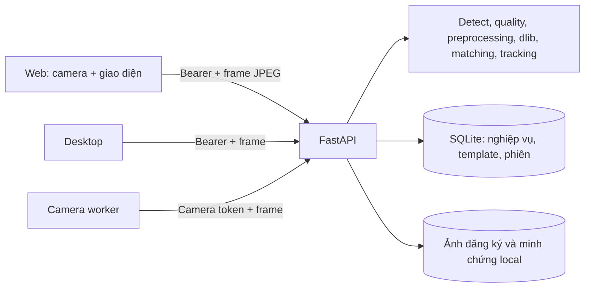

# Mô tả hệ thống hiện hành

Tài liệu mô tả mã trong repository, phục vụ tìm hiểu và xây dựng báo cáo môn học;
không phải báo cáo kết quả nghiệm thu. Đối chiếu với cấu hình `.env`, phiên bản
commit và kết quả đo trên máy trình diễn trước khi trích dẫn con số. Các tài liệu
cũ có thể mô tả các thiết kế đã thay đổi; trạng thái hiện tại được nêu tại đây.
Danh mục tài liệu và cách lấy bằng chứng ở [README tài liệu](README.md).

## 1. Mục tiêu và phạm vi

AttendAI là bản demo điểm danh sinh viên bằng khuôn mặt chạy local. Người vận hành
quản lý sinh viên, lớp, sự đồng ý và buổi học; đăng ký Face ID năm góc qua camera;
quét nhiều khuôn mặt trong cùng khung; xem/sửa kết quả và xuất báo cáo. Bản demo
có web, desktop và camera worker; web là luồng được mô tả chi tiết dưới đây.
Web hiện dành cho admin; teacher/user có phân quyền API và client phù hợp,
chưa có web riêng đầy đủ. Tạo lớp/tài khoản mới chưa có form web chuyên biệt.

Hệ thống **không kiểm tra liveness/PAD**: không thể tuyên bố chống ảnh in, video
phát lại hoặc camera ảo. Không nhận diện/điểm danh giảng viên bằng khuôn mặt.
Không có bằng chứng nghiệm thu độ chính xác trên tập người thật trong repository;
các kết quả thử nhỏ phải được ghi kèm điều kiện và giới hạn mẫu.

## 2. Kiến trúc và thành phần

- [frontend](../frontend): HTML/CSS/JavaScript, camera trình duyệt và thao tác
  quản trị. Preview được mirror bằng CSS; frame gửi đến server không bị mirror bởi CSS.
- [backend/app](../backend/app): FastAPI, xác thực, quyền, nghiệp vụ và API.
  [attendance.py](../backend/app/services/attendance.py) xử lý bản ghi, giờ và
  điều chỉnh; [stream_recognition.py](../backend/app/services/stream_recognition.py)
  điều phối từng frame và gallery của lớp.
- [ai_pipeline](../ai_pipeline): decode ảnh, detector, kiểm tra chất lượng,
  biến đổi hình học/ánh sáng, trích embedding, so khớp và xác nhận track.
- SQLite mặc định tại `attendance.db`; ảnh đăng ký/ảnh minh chứng nằm trong
  `storage/`. Các đường dẫn có thể đổi bằng biến cấu hình. Backend tạo bảng khi
  khởi động và có migration SQLite nhẹ cho một số cột cũ.

## 3. Dữ liệu và nghiệp vụ

Các thực thể chính trong [models.py](../backend/app/models.py): `User`, `Student`,
`Class`, `ClassEnrollment`, `ClassSession`, `FaceTemplate`, `FaceEnrollmentDraft`,
`RecognitionEvent`, `AttendanceRecord`, `AuditLog`, `AuthSession` và
`DeviceClassAccess`. Một sinh viên có thể được ghi danh vào nhiều lớp; một lớp
có nhiều buổi. Ràng buộc `(session_id, student_id)` ngăn hai bản ghi điểm danh
cho cùng một người trong một buổi.
Lớp hành chính `class_label` chỉ là nhãn; `ClassEnrollment` mới quyết định một
người có được tìm trong gallery của buổi hay không. Chi tiết schema/ERD và vòng
đời dữ liệu nằm ở [DATA_MODEL](DATA_MODEL.md). Lịch sử bảng dùng roster hiện tại,
chưa có snapshot thành viên; xóa mềm không xóa vật lý ảnh/vector.

Một lớp chỉ được mở một buổi tại một thời điểm theo luồng tạo buổi. Giờ vào học
và số phút cho phép trễ xác định kết quả: đến trước/bằng hạn là `present`, sau
hạn là `late`; số phút trễ làm tròn lên. Khi đóng buổi, người ghi danh chưa có
bản ghi được thêm trạng thái `absent`. Người có quyền có thể điều chỉnh thủ công
với lý do và audit; trạng thái điều chỉnh không bị quét tự động ghi đè. Ngày giờ
API chuẩn hóa UTC, web hiển thị giờ địa phương của trình duyệt.

Seed trong [seed_demo.py](../scripts/seed_demo.py) tạo dữ liệu **giả lập** có mã
`DEMO`: tối đa ba lớp, 12 hồ sơ, ba buổi lịch sử đã đóng và hai buổi mở. Mỗi
buổi mở có hai kết quả mẫu, còn lại chờ. Các bản ghi là dữ liệu nhập thủ công
giả lập, không phải kết quả model. Giờ vào buổi mở là 30 phút trước lúc seed;
không tạo FaceTemplate, ảnh, event nhận diện hay
embedding. Chạy lặp không ghi đè các bản ghi đã có. Nếu trùng mã với dữ liệu
không phải seed, mã đó được bỏ qua. Xem README để khởi tạo trên máy mới.

## 4. Đăng ký Face ID

Chỉ sinh viên đang được ghi nhận đồng ý mới có thể đăng ký. API decode JPEG,
áp EXIF, kiểm tra chỉ một mặt và chất lượng, dùng landmark/ước lượng pose để
xác nhận lần lượt `front`, `left`, `right`, `up`, `down`. `face_recognition`/dlib
trích vector 128 chiều; template lưu kèm nhãn góc, tên model và `model_version`.
Ảnh xem trước lưu dưới dạng ảnh chân dung chuẩn hóa. Cần đủ cả năm góc của cùng
profile/model thì mẫu mới đủ điều kiện nhận diện.
Web lấy góc chính diện làm mốc yaw/pitch, chấp nhận quay/ngẩng nhẹ và giữ yên;
mặc định một jitter cho embedding đăng ký. Ngưỡng hướng dẫn cụ thể và chất lượng
nguồn ở [IMAGE_PROCESSING](IMAGE_PROCESSING.md). Các ngưỡng này không thay
ngưỡng matching. Summary chỉ báo hoàn tất cho profile đang chạy; mẫu khác phiên
bản được báo cần quét lại. Camera đăng ký có nút tắt, xử lý có trạng thái chờ
và timeout 45 giây. Đăng ký đủ góc vẫn cần consent và ghi danh đúng lớp để điểm danh.

Giao diện mới khởi tạo `FaceEnrollmentDraft` bằng mã lượt và lưu tạm từng góc;
bộ mẫu đang dùng được giữ đến khi đủ năm góc mới. Khi đủ, các mẫu cũ được vô
hiệu hóa và bộ mới được kích hoạt trong một giao dịch DB. Hủy, khởi tạo lượt mới,
xóa sinh viên hoặc thu hồi/chuyển trạng thái đồng ý dọn mẫu tạm; nếu mất kết nối
trước khi hủy, mẫu tạm có thể còn trong DB đến lần xử lý tiếp theo. Endpoint
`/face-enrollment/reset` cũ vẫn vô hiệu hóa mẫu đang hoạt động, phục vụ tương thích.

## 5. Pipeline điểm danh nhiều mặt

1. Web đọc frame camera, mã hóa JPEG và gửi `/sessions/{id}/scan-stream` với
   `stream_id`, `frame_id` tăng dần. Mỗi luồng có tối đa một request đang xử lý;
   video tiếp tục hiển thị trong lúc chờ. Frame có nội dung lặp trong cửa sổ hash
   gần đây không được tính thêm bằng chứng.
2. Server kiểm tra phiên/lớp/quyền và engine, decode ảnh; detector tìm box mặt.
   Từng mặt được đánh giá chất lượng và xử lý theo profile; tối đa tám mặt/frame
   theo mặc định, các box vượt ngân sách được luân phiên xử lý ở frame sau.
3. Dlib trích embedding 128D. Gallery chỉ gồm sinh viên thuộc lớp, chưa xóa,
   còn đồng ý và có đủ năm góc cùng `model_version`. Mỗi người dùng khoảng cách
   Euclidean nhỏ nhất đến các template của họ; kiểm tra ngưỡng mặc định 0,52 và
   khoảng cách tới ứng viên thứ hai qua margin 0,04.
4. Tracker ghép box dựa trên IoU, dự đoán chuyển động và embedding, rồi yêu cầu
   các lần so khớp mới cho từng track. Mặc định ba lần, cách nhau tối thiểu 0,25 s,
   kéo dài tối thiểu 0,5 s, cửa sổ 30 s; quá 10 s không quan sát phải xác nhận lại.
   Các số này là cấu hình, không chứng minh xác suất nhận sai.
5. Với nhận diện đã xác nhận, server tạo sự kiện và bản ghi điểm danh theo quy tắc
   trùng; có thể lưu crop ảnh minh chứng. Giao diện hiển thị khung xanh + tên khi
   đã có bản ghi, khung vàng khi chờ và tiếp tục xử lý người khác. Kiểm tra thay
   đổi pixel chỉ ẩn overlay cũ, không xác nhận danh tính hay chống giả mạo.

Nếu ảnh không đạt chất lượng, không có mẫu phù hợp, danh tính mơ hồ hoặc engine
thiếu, mặt đó không được tự động điểm danh. Người vận hành vẫn có thể xử lý thủ công.

Web hiển thị lịch sử trong 100 buổi gần nhất; buổi đã đóng vẫn xem bảng, xuất
CSV và điều chỉnh thủ công có lý do. Camera và thao tác thay giờ bị khóa cho
buổi đóng. Bỏ chọn/đổi buổi xóa thống kê và log tạm của buổi trước trên màn hình,
không xóa dữ liệu đã lưu. Nút Làm mới cập nhật cả bảng và số Face ID sẵn sàng.

## 6. Thuật toán xử lý ảnh và cấu hình

Mặc định trong [config.py](../backend/app/config.py) và
[.env.example](../.env.example), có thể khác `.env` đang chạy:

| Cấu hình | Mặc định | Ý nghĩa |
| --- | --- | --- |
| PREPROCESSING_MODE / VERSION | enforce / v3 | Cùng profile khi đăng ký và nhận diện. |
| FACE_DETECTION_BACKEND | hog | YuNet/hybrid là lựa chọn sau khi tải model riêng. |
| PREPROCESSING_V2_ALIGN_EYES / DENOISE_METHOD | false / off | Giữ căn chip nội bộ dlib, không lọc sạch ảnh mặc định. |
| ENROLLMENT_NUM_JITTERS | 1 | Số lần jitter khi trích mẫu, không phải số góc. |
| FACE_DISTANCE_THRESHOLD / MARGIN | 0,52 / 0,04 | Khoảng cách tốt nhất và độ cách biệt với người thứ hai. |
| ATTENDANCE_MIN_HITS | 3 | Ba lần khớp mới trong track. |
| STREAM_CONFIRMATION_WINDOW_SECONDS / MAX_OBSERVATION_GAP_SECONDS | 30 / 10 | Cửa sổ bằng chứng và gián đoạn tối đa. |
| STREAM_MAX_FACES_PER_FRAME | 8 | Giới hạn encode mỗi frame; không phải FPS hoặc số người nghiệm thu. |
| AUTH_SESSION_HOURS | 8 | Hạn phiên bearer. |

V3 là tên profile tiền xử lý; OpenAPI vẫn có phiên bản ứng dụng `1.0.0-demo`.

Detector HOG là mặc định; `hybrid`/`yunet` là lựa chọn nếu có model YuNet. Chất
lượng kiểm tra kích thước tối thiểu 80 px, độ sáng và phương sai Laplacian; v2 đo
thêm tương phản, vùng tối/cháy, gradient và chỉ số nhiễu. Các ngưỡng là heuristic,
cần thử trên camera đích. Xem [quality.py](../ai_pipeline/quality.py).

`PREPROCESSING_MODE=enforce` và `PREPROCESSING_VERSION=v3` là mặc định trong
`.env.example`; đăng ký và nhận diện dùng cùng profile v3.
`shadow` đo nhánh ứng viên mà không thay quyết định; `enforce` dùng profile cấu
hình. V1 có thể tìm xoay/roll, căn mắt và CLAHE. V2 có thể chọn gamma/CLAHE theo
ROI, xử lý nhiễu tùy chọn và có giới hạn số lần thử detector; mặc định không căn
mắt ngoài và không lọc nhiễu. Với v1 enforce, shadow v2 có thể lấy mẫu 10% frame.
Có thể chọn v3 làm nhánh lấy mẫu đối chiếu mà không đổi quyết định v1 bằng
`PREPROCESSING_SHADOW_CANDIDATE_VERSION=v3`.
Cấu hình v3 kế thừa v2 và bổ sung biên chuyển tiếp cho ROI, cứu ảnh
tối vừa phải nếu ảnh nguồn vẫn đủ chi tiết và ảnh sau gamma qua lại kiểm tra
chất lượng. Khi detector ban đầu bỏ sót ảnh tối, v3 có một lần tăng sáng chỉ để
tìm vị trí mặt; ảnh tăng sáng này không được dùng làm bằng chứng chất lượng hay
đầu vào trực tiếp cho model. V3 cũng có tối đa hai lần tìm thêm mặt nghiêng khi quét nhiều người. Các
khung phát hiện từ góc khác nhau được quy về tọa độ gốc và gộp trùng; phép tìm
thêm làm tăng độ trễ; vì vậy cần kiểm tra hiệu năng trên camera đích. V3
dùng mã profile khác v1/v2; chỉ mẫu cùng profile mới được dùng để điểm danh.
Các phép này không dựng phần mặt bị che, và chưa có bằng chứng mọi cấu hình đều
cải thiện nhận diện. Trọng số ResNet không được huấn luyện lại trong repository.

Thay đổi tham số ảnh hưởng profile/model có thể làm template cũ không tương thích;
không tự đổi nhãn vector. [FACE_ANALYSIS.md](FACE_ANALYSIS.md) và
[PREPROCESSING_BENCHMARK.md](PREPROCESSING_BENCHMARK.md) mô tả các lựa chọn.

## 7. API, bảo mật và dữ liệu qua máy

Web/desktop đăng nhập lấy bearer token; token có hạn, được thu hồi khi đăng xuất,
DB lưu hash token. Password mới dùng PBKDF2 có salt; mã cũ SHA-256 được hỗ trợ
và nâng cấp lúc đăng nhập. Phân quyền lớp kiểm tra tại backend. Worker dùng
`X-Camera-Token` riêng. Đây là demo local, không phải khẳng định đáp ứng mọi yêu
cầu bảo mật production. Chi tiết endpoint, schema và mã lỗi ở [API.md](API.md).

Git bỏ qua `.env`, `attendance.db` và `storage/`, nên pull chỉ mang code và dữ
liệu seed được mô tả bằng code. [transfer_metadata.py](../scripts/transfer_metadata.py)
cho phép xuất/nhập riêng hồ sơ/lớp/ghi danh/buổi/điểm danh dạng JSON. Không xuất
ảnh, vector, FaceTemplate, draft, event nhận diện, ảnh minh chứng, password, token
hay audit gốc. Nhập không ghi đè bản ghi trùng; buổi mở xung đột bị bỏ qua. JSON
vẫn chứa thông tin cá nhân nếu xuất dữ liệu thật và không được tự động đưa lên Git.

## 8. Kiểm thử và giới hạn kết luận

Unit/integration dùng pytest và DB test; browser test dùng camera tổng hợp, không
phải đo chính xác của model. [THU_NGHIEM_DO_AN.md](THU_NGHIEM_DO_AN.md) hướng dẫn
thử số người, độ trễ, đúng/nhầm/bỏ sót và điều kiện camera. Công cụ benchmark
so sánh profile trên cùng manifest; công cụ đánh giá stream làm replay ngoại tuyến.
Các phép đo này có phạm vi khác nhau, không coi latency offline là FPS camera–UI.

Quan sát smoke cũ (31/10/2026, trước đợt rà soát UX này): trên một người đã đăng ký với bốn probe từ
ảnh ví dụ và một probe người lạ, legacy đúng 3/4, v1 và v2-adaptive đúng 4/4;
không nhận nhầm probe lạ duy nhất. Dữ liệu và biến thể quá ít để công bố accuracy
hay FAR. Phép ghép hai ảnh công khai đo khoảng 3,18 s cho một frame hai mặt trên
CPU sau làm nóng; không gồm mạng/DB/UI và không phải kiểm thử đông người thực.

Hệ thống xác nhận track trong RAM một process; nhiều worker/replica cần định tuyến
cố định hoặc store dùng chung. Không cam kết FPS, hiệu quả trong mọi ánh sáng/góc,
khả năng chống giả mạo, độ công bằng hay khả năng triển khai production khi chưa đo.
